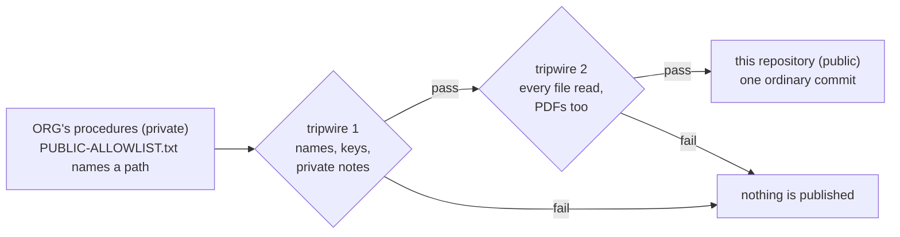

# ORG procedures, public

*The public shelf of the Octagon Religious Research Group's standard operating procedures.*

## What this is

A **proposal** asks for a decision; a **procedure** says how an approved thing is done, step by step, so a person or
their helper can do it without the author in the room. ORG keeps its procedures in a private repository for its members.
This public repository receives only the ones its officers choose to share.

## What is here today

**Nothing yet.** On 2026-11-01 the nine universal procedures were proposed for the allowlist
([pull request #1](https://github.com/Octagon-Religious-Research-Group-ORG/ops-standard-operating-procedures/pull/1), members only):
SOP-COM-001 *New to GitHub: your first hour*, SOP-OPS-001/002/003, SOP-IT-001/002/003 and SOP-GOV-002, each as
markdown with its PDF beside it, and the icons they draw. They arrive after an officer's yes and the first sync, and stay
drafts until ORG tags an approved set. **New to GitHub?** Start with SOP-COM-001 once it is here, or with ORG's
[welcome deck](https://github.com/Octagon-Religious-Research-Group-ORG/.github/blob/main/decks/welcome.marp.pdf) today.

## How a procedure gets here

- An officer adds a line to `PUBLIC-ALLOWLIST.txt` in the private repository, by pull request.
- A workflow there copies only the listed paths here, after two automatic checks (the second reads every file, PDFs included, or a person attests they read it), with a deploy key that opens this
  one repository and nothing else. Removing the line removes the path here on the next run.
- **Nobody edits this repository by hand.** `main` carries a deletion-only ruleset; this README is its own and is never
  overwritten by the sync.

## Elsewhere

[ORG Reading Room, public](https://octagon-religious-research-group-org.github.io/reading-room-public/) ·
[orgspirituality.org](https://orgspirituality.org) ·
[Entry portal](https://octagon-religious-research-group-org.github.io/) ·
[ORG AstroLog](https://octagon-religious-research-group-org.github.io/changelog-astro-public/) ·
[Contacts](https://github.com/Octagon-Religious-Research-Group-ORG/.github/blob/main/CONTACTS.md)

Written content: CC BY-SA 4.0 (see ORG's <a href="https://github.com/Octagon-Religious-Research-Group-ORG/.github/blob/main/LICENSE-CONTENT">LICENSE-CONTENT</a>). ORG's names and marks are reserved.
